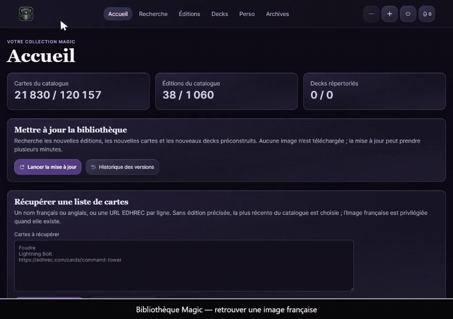

<h1> Bibliothèque Magic locale</h1>

Bibliothèque locale de cartes Magic: The Gathering pour Windows. L’application télécharge le catalogue, puis permet de rechercher une carte et de récupérer son image à la demande, en privilégiant les versions françaises. Si une impression n’a pas d’image française satisfaisante, Codex CLI peut préparer une version française à partir d’un visuel anglais.

Le dépôt contient le programme, pas une bibliothèque déjà constituée : catalogue, archives téléchargées, images, decks personnels, configuration et sauvegardes restent locaux. Une connexion Internet est nécessaire pour le premier import et les mises à jour.

## Installation sous Windows

Installer Python 3.11 avec le lanceur `py`, puis, dans PowerShell à la racine du dépôt :

```powershell
py -3.11 -m venv _bibliotheque_mtg\.venv
& .\_bibliotheque_mtg\.venv\Scripts\python.exe -m pip install -r .\_bibliotheque_mtg\src\python\requirements_bibliotheque.txt
Copy-Item .\_bibliotheque_mtg\config.example.json .\_bibliotheque_mtg\config.json
```

Les chemins de la configuration d’exemple sont relatifs au fichier lui-même. Le `config.json` de chaque installation reste local.

Pour construire le catalogue depuis zéro, lancer la commande suivante et attendre le statut `initialized`.

```powershell
.\Initialiser_Bibliotheque_Magic.bat
```

Prévoir 15 Gio libres. À titre indicatif, une archive All Cards récente pesait environ 389 Mio compressés, et le catalogue occupe plusieurs Gio. L’import télécharge les métadonnées et crée les emplacements d’image vides.

Double-cliquer ensuite sur `Lancer_Bibliotheque_Magic.bat` et ouvrir `http://127.0.0.1:8765/` si nécessaire. Pour actualiser les métadonnées, utiliser `Mettre_a_jour_bibliotheque.bat` ou la page Info. Les images sont récupérées à la demande depuis les fiches.

Le catalogue est normalement sous `_bibliotheque_mtg/v3-staging/` ; une installation existante peut utiliser l'ancien chemin `_bibliotheque_mtg/work/v3-staging/`. Le pointeur `current.json` désigne la version active. Voir le [guide d'utilisation](README_Bibliotheque_Magic.md) pour les données à sauvegarder et les options.

## Développement et tests

Le code est sous `_bibliotheque_mtg/src/python/`. Pour installer les outils de test et exécuter la suite depuis ce dossier :

```powershell
& ..\..\.venv\Scripts\python.exe -m pip install "pytest>=9,<10"
& ..\..\.venv\Scripts\python.exe -m pytest -q
```

Tesseract est facultatif pour l'OCR et Codex CLI pour les fonctions qui l'utilisent ; ils ne sont pas nécessaires à la recherche ordinaire. Voir le guide pour la configuration OCR.


## Visite de l’application



La démonstration utilise une copie du catalogue. Depuis la loupe, elle récupère et enregistre l’image française d’*Arme Diamant*. Elle reproduit ensuite la recherche pour *Noctis*, utilise le visuel anglais pour demander une génération française à Codex CLI, puis compare et enregistre le résultat. Le texte d’une carte générée doit être relu avant utilisation.

### Images françaises avec Codex CLI

Lorsqu’aucune image française satisfaisante n’existe, l’application peut demander au Codex CLI local de préparer une candidate. Une image existante sert de référence visuelle, tandis qu’une carte française ou les données officielles locales fournissent le texte. La dernière étape compare les deux références et la version générée avant toute validation : rien n’est remplacé automatiquement. Ce parcours s’appuie sur [l’outil image du projet open source Codex](https://github.com/openai/codex/blob/main/codex-rs/ext/image-generation/src/tool.rs).

### Archives et decks

- **Archives** — Déposez vos anciennes images de cartes dans [`Cartes Magic/`](Cartes%20Magic/README.md), à la racine du projet. Ouvrez **Archives** pour les parcourir, lancer la reconnaissance de texte (OCR local via Tesseract) et associer une image à la bonne impression avant de l’importer. L’OCR est expérimental et peut se tromper ou ne rien trouver. Vérifiez les propositions et choisissez l’impression manuellement si nécessaire. Le dossier est livré vide d’images et fonctionne sans index historique.
- **Decks** — Consultez les listes préconstruites ou composez un deck personnel, avec sections, couleurs et quantités. L’export peut rassembler les images sur le Bureau.
