# Bibliothèque Magic locale


Application Windows de consultation d'un catalogue Magic: The Gathering : recherche et filtres, fiches de cartes, images à la demande, decks préconstruits et personnels, exports et historique des versions. Les métadonnées proviennent notamment de Scryfall et les decks préconstruits de MTGJSON.

Le dépôt contient le programme, pas une bibliothèque déjà constituée : catalogue, archives téléchargées, images, decks personnels, configuration et sauvegardes restent locaux. Une connexion Internet est nécessaire pour le premier import et les mises à jour.

## Installation sous Windows

Installer Python 3.11 avec le lanceur `py`, puis, dans PowerShell à la racine du dépôt :

```powershell
py -3.11 -m venv _bibliotheque_mtg\.venv
& .\_bibliotheque_mtg\.venv\Scripts\python.exe -m pip install -r .\_bibliotheque_mtg\src\python\requirements_bibliotheque.txt
Copy-Item .\_bibliotheque_mtg\config.example.json .\_bibliotheque_mtg\config.json
```

Les chemins de la configuration d’exemple sont relatifs au fichier lui-même. Le `config.json` de chaque installation reste local.

Pour construire le catalogue depuis zéro, lancer la commande suivante et attendre le statut `initialized`.

```powershell
.\Initialiser_Bibliotheque_Magic.bat
```

Prévoir 15 Gio libres. À titre indicatif, une archive All Cards récente pesait environ 389 Mio compressés, et le catalogue occupe plusieurs Gio. L’import télécharge les métadonnées et crée les emplacements d’image vides.

Double-cliquer ensuite sur `Lancer_Bibliotheque_Magic.bat` et ouvrir `http://127.0.0.1:8765/` si nécessaire. Pour actualiser les métadonnées, utiliser `Mettre_a_jour_bibliotheque.bat` ou la page Info. Les images sont récupérées à la demande depuis les fiches.

Le catalogue est normalement sous `_bibliotheque_mtg/v3-staging/` ; une installation existante peut utiliser l'ancien chemin `_bibliotheque_mtg/work/v3-staging/`. Le pointeur `current.json` désigne la version active. Voir le [guide d'utilisation](README_Bibliotheque_Magic.md) pour les données à sauvegarder et les options.

## Développement et tests

Le code est sous `_bibliotheque_mtg/src/python/`. Pour installer les outils de test et exécuter la suite depuis ce dossier :

```powershell
& ..\..\.venv\Scripts\python.exe -m pip install "pytest>=9,<10"
& ..\..\.venv\Scripts\python.exe -m pytest -q
```

Tesseract est facultatif pour l'OCR et Codex CLI pour les fonctions qui l'utilisent ; ils ne sont pas nécessaires à la recherche ordinaire. Voir le guide pour la configuration OCR.


## Visite de l’application

Les captures proviennent de l’application locale. Les données affichées dépendent de chaque installation. Les recherches et les ouvertures de fiches ci-dessous n’ont pas modifié la bibliothèque.

### Accueil

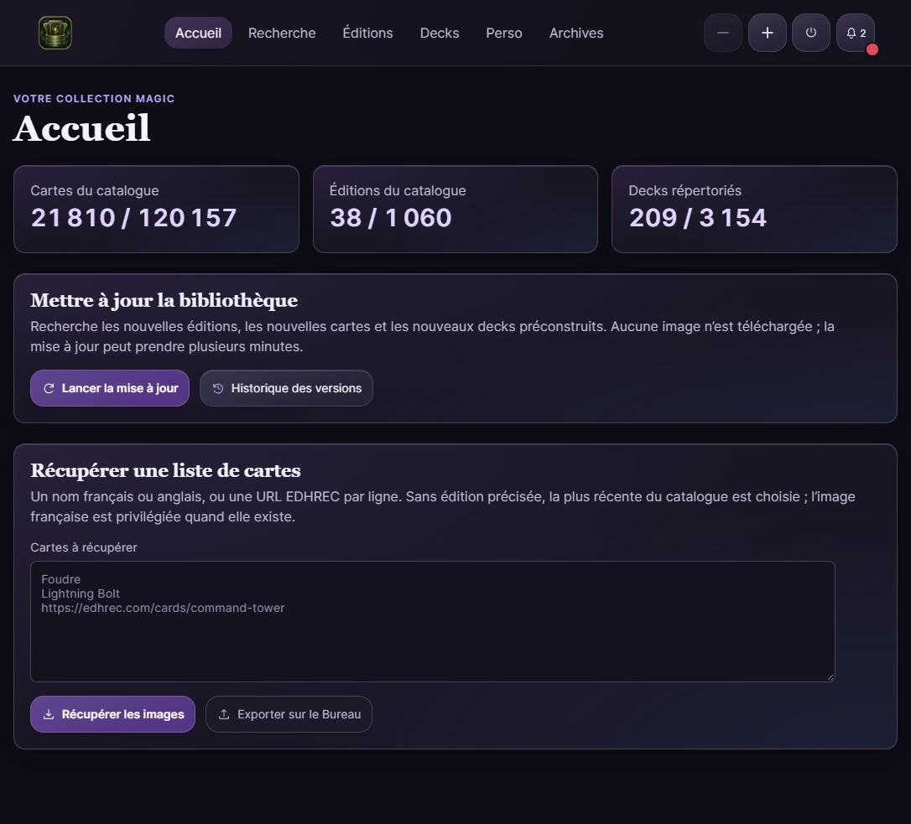

L’accueil résume les cartes, éditions et decks disponibles. Il permet de lancer une mise à jour, de consulter les versions conservées et de récupérer une liste de 100 cartes au maximum, par noms français ou anglais ou URL EDHREC. La récupération télécharge des images ; l’export crée des PNG sur le Bureau.

### Recherche et fiche

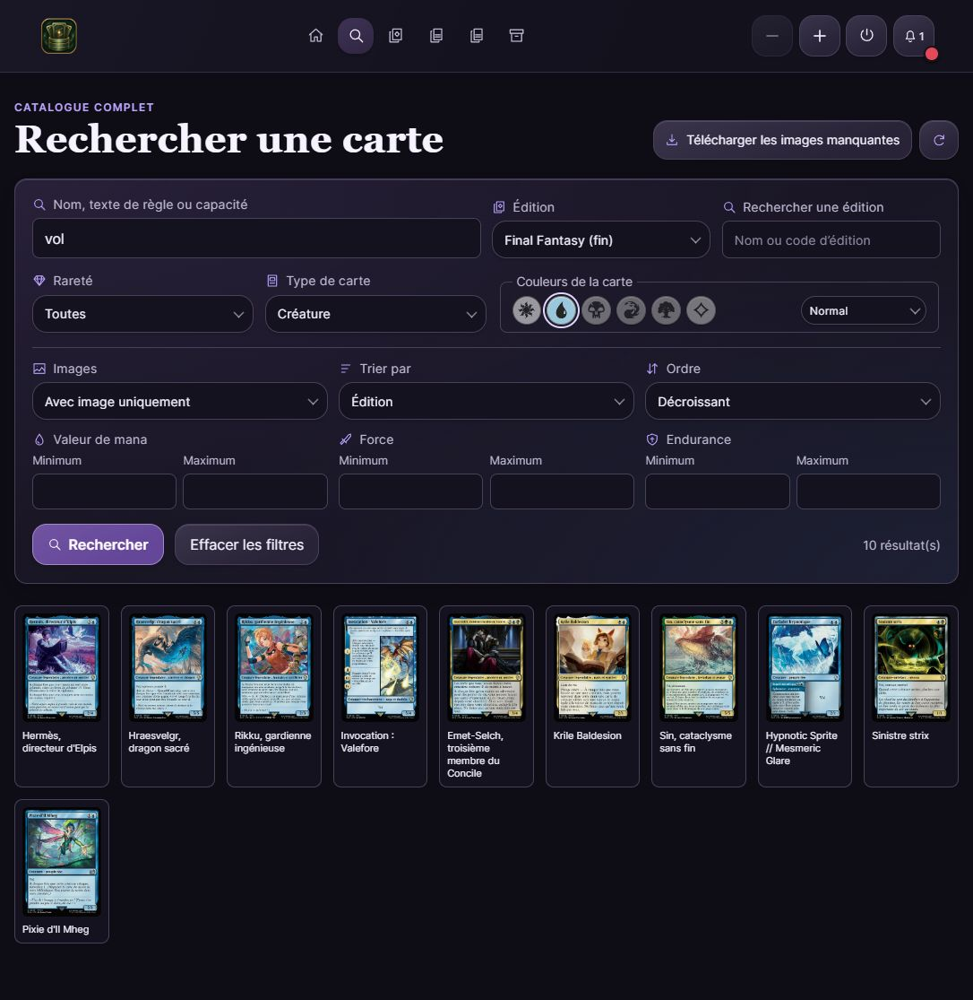

Cet exemple cherche « vol » dans Final Fantasy, parmi les créatures bleues ayant déjà une image. Les filtres couvrent aussi rareté, valeur de mana, force, endurance et tri. Chaque résultat est une impression exacte. Le bouton de rafraîchissement relit les images locales ; le téléchargement groupé traite les images manquantes de la sélection.

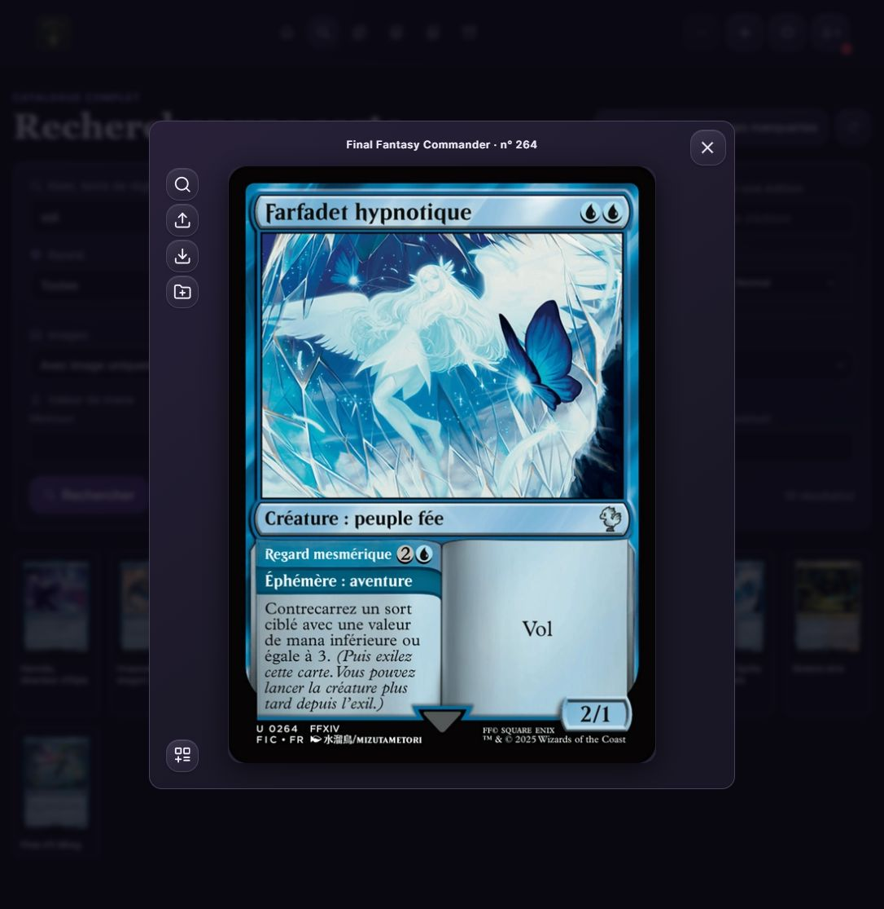

La visionneuse affiche les faces et permet de parcourir les résultats, d’ajouter la carte à un deck personnel, d’importer ou d’exporter une image et de rechercher une meilleure image.

### Éditions

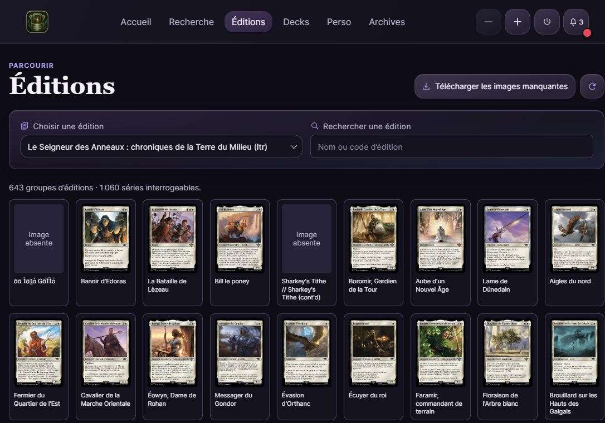

Choisir une édition par son nom ou son code affiche ses cartes avec pagination. On peut ouvrir chaque fiche, rafraîchir l’état local ou demander les images manquantes de l’édition.

### Decks préconstruits

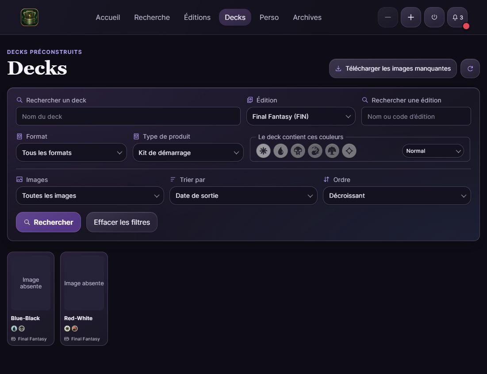

L’index MTGJSON se recherche par nom, édition, format, type de produit, couleurs et disponibilité des images. Ouvrir un deck donne sa composition, ses commandants et ses jetons. Le chargement des images et l’export sont des actions explicites.

### Decks personnels

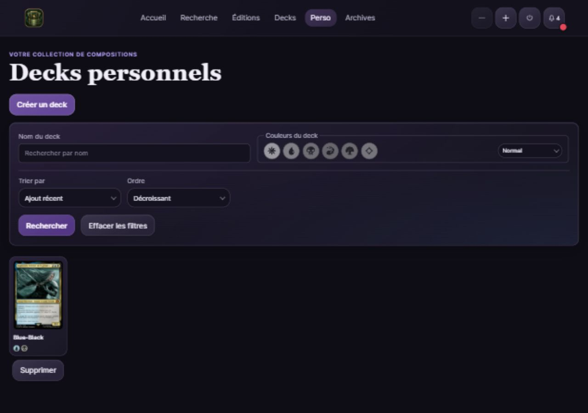

L’onglet Perso sert à créer ou copier une composition, puis à la retrouver par nom ou couleurs. L’exemple montre le kit de démarrage Final Fantasy **Blue-Black** ajouté à la bibliothèque personnelle.

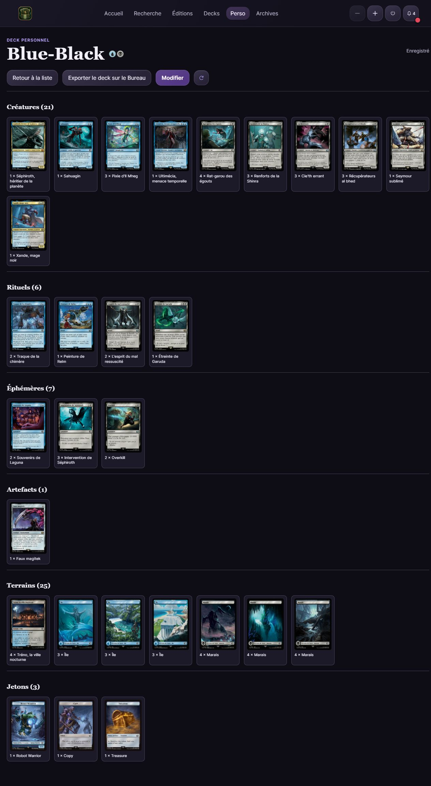

Ouvrir le deck affiche ses cartes réparties par sections et leurs quantités. Le bouton **Exporter le deck sur le Bureau** crée un dossier d’images lorsque les images nécessaires sont disponibles.

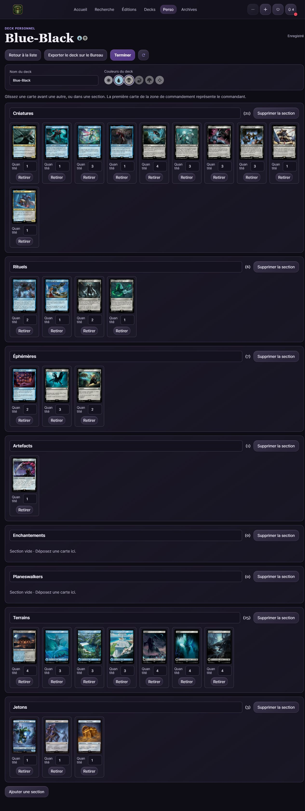

**Modifier** permet de renommer le deck, de choisir ses couleurs, de déplacer les cartes, de régler leurs quantités et de gérer les sections. La mention **Enregistré** confirme la sauvegarde. Les captures ont été prises sans changer le deck.

### Archives

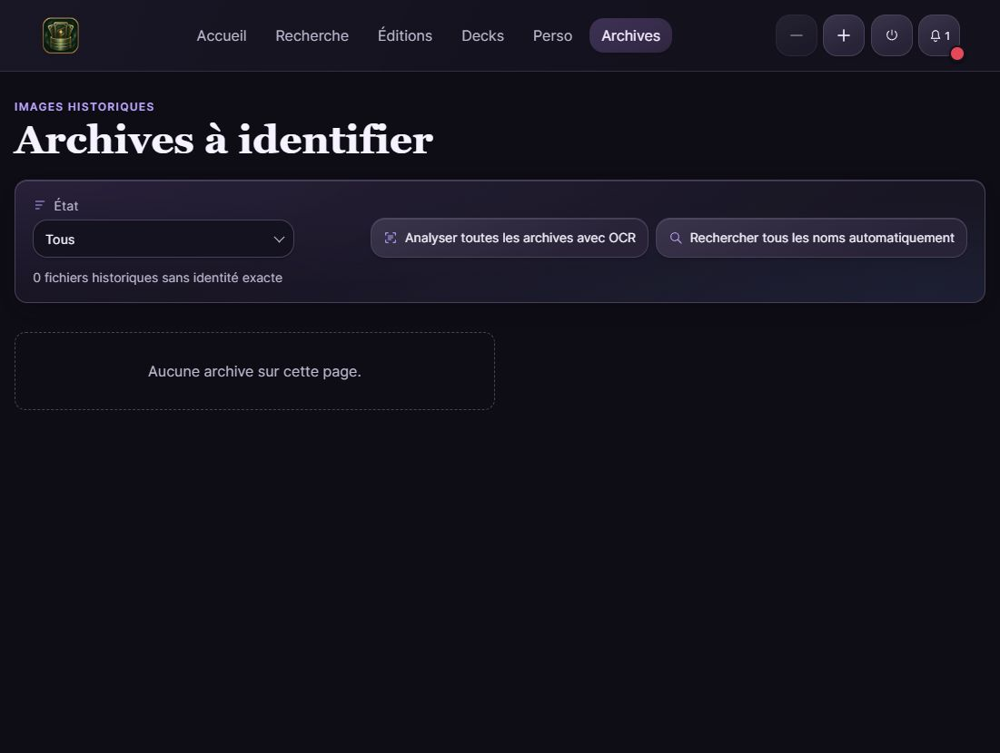

Les anciennes images non rapprochées d’une impression précise restent séparées du catalogue. La page permet un filtrage par état, une lecture OCR, une recherche de nom et une attribution manuelle avant import. L’installation photographiée ne contenait pas d’archive non résolue.

### Choix d’image et génération française

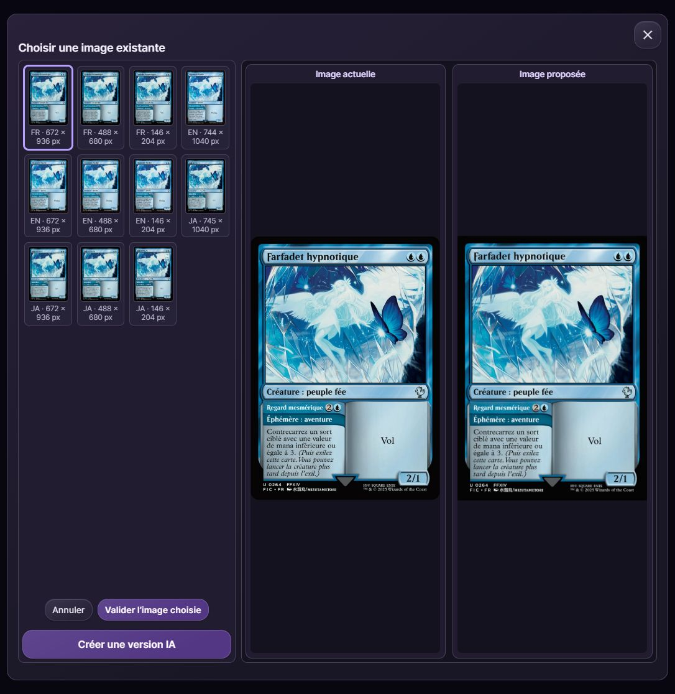

Depuis la fiche, la recherche de meilleure image présente des candidates FR, EN et JA avec leurs dimensions. L’image actuelle et la proposition sont comparées avant validation.

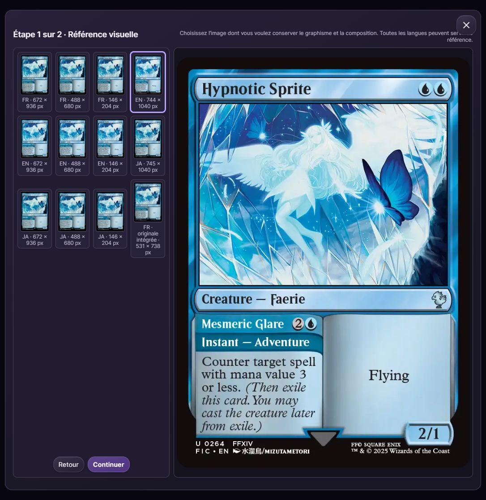

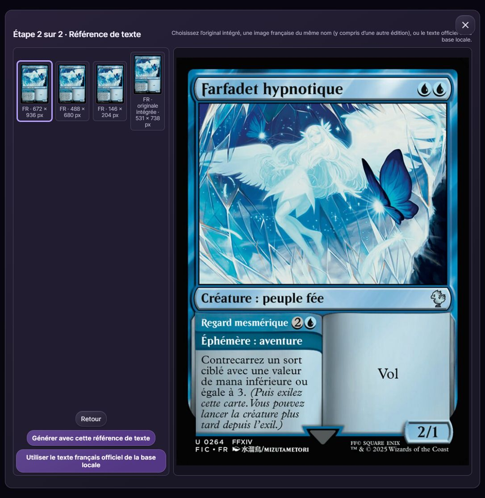

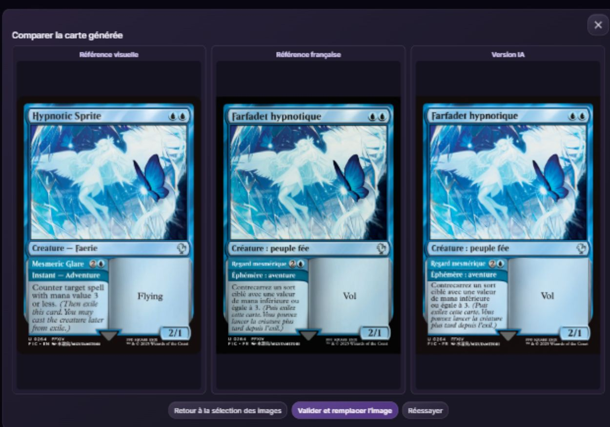

Si aucune image française satisfaisante n’existe, le parcours peut créer une candidate avec le Codex CLI installé localement. La première référence fournit le graphisme ; le texte français provient d’une image française choisie ou des données officielles locales. Une candidate doit être comparée et acceptée explicitement avant de remplacer l’image. Vérifiez son illustration, ses symboles et tout son texte : la fidélité n’est pas certifiée automatiquement. La cloche permet de reprendre le suivi d’une génération en cours. Ce parcours s’appuie sur [l’outil image du projet open source Codex](https://github.com/openai/codex/blob/main/codex-rs/ext/image-generation/src/tool.rs).

La capture montre une génération réelle laissée à l’étape de revue : aucune image du catalogue n’a été remplacée pour cette démonstration.
